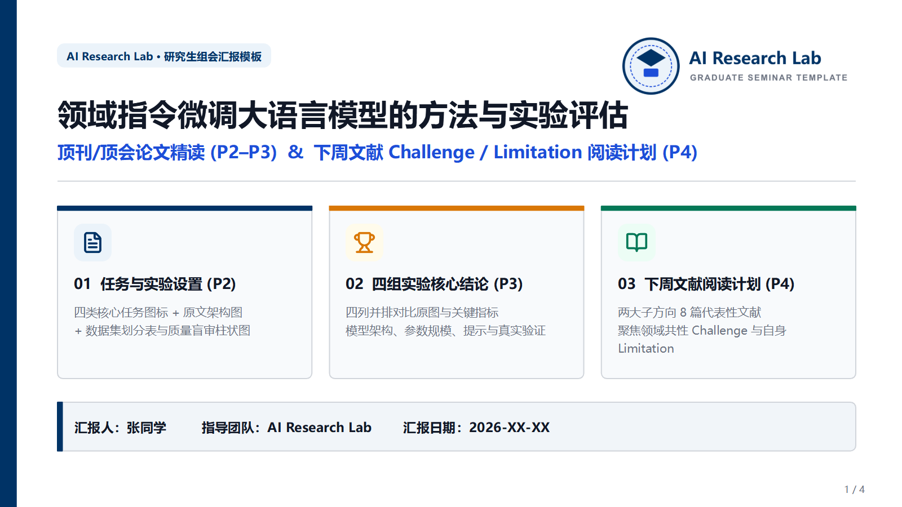
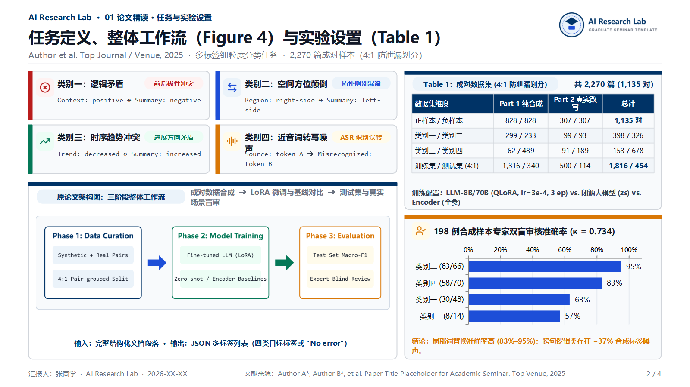
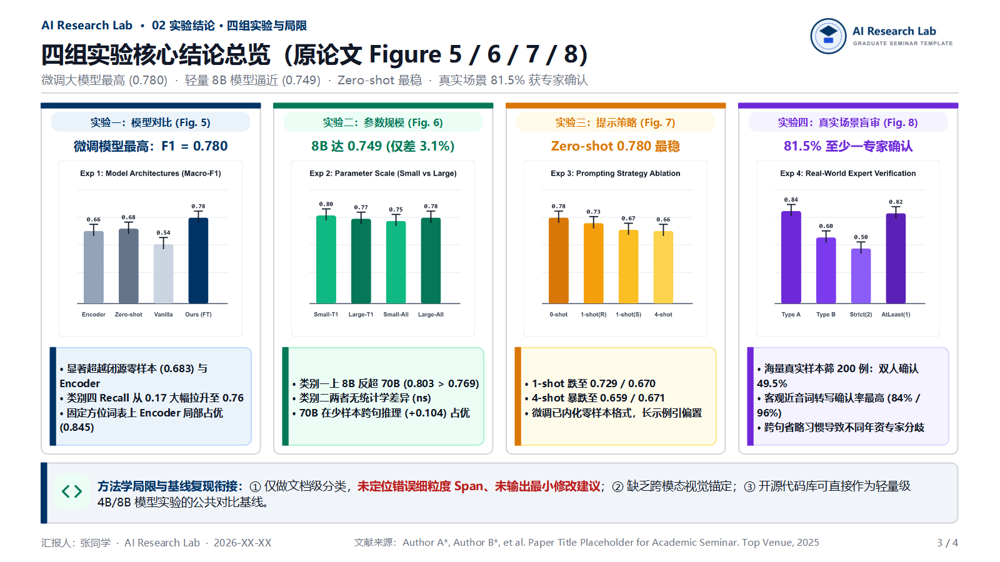
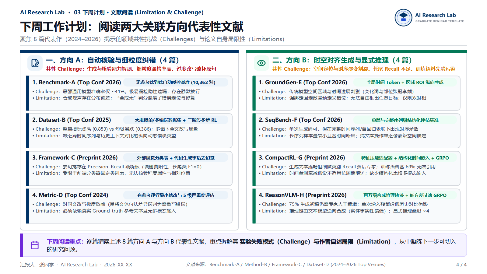

# 学术组会高密度汇报 PPT 生成技能 (`group-meeting-ppt`)

这是一个面向 **Google Antigravity** 与 **Claude Code** 的研究生学术组会 PPT 制作 Skill（技能包）。它通过 `PptxGenJS` + `Lucide` + `Sharp` + `PowerPoint COM` 自动化流水线，将论文精读、多组实验对比与文献阅读计划转化为**高信息密度、图表驱动、结构严谨的 4–5 页学术风演示文稿（`.pptx`）**，并同步生成**逐页详细口播稿**与**3–5 分钟简短进展汇报稿（`.md`）**。

---

## ✨ 核心设计理念与特性

1. **精炼 4–5 页高密度学术结构（拒绝冗长文字墙）**：
   - **第 1 页（开场封面页）**：右上角自定义实验室/院校徽标、组会徽章、主副标题、3–4 张汇报模块导航卡片及底部汇报人信息栏。
   - **第 2 页（任务定义、整体工作流与实验设置）**：
     - 左上：2×2 核心任务/类别定义图标卡片（含单行 `Consolas` 示例）；
     - 左下：嵌入**原论文整体架构/工作流高清原图**及输入输出规范；
     - 右上：数据集构成与防泄漏划分统计表（`Table 1`）+ 模型训练超参；
     - 右下：原生横向柱状图（如数据质量专家盲审准确率）+ 一句话核心发现。
   - **第 3 页（多组实验核心结论并排对比总览）**：
     - **3–4 列并排卡片布局**：每列顶部为实验标签胶囊与核心指标大字标题，中部嵌入**裁剪自原论文的高清实验结果图（如 `Figure 5 / 6 / 7 / 8`）**，下部为带左色条的 3 条精炼结论；
     - **底部通栏**：一句话总结论文的方法学局限（Limitations）及与自身实验/开源基线的衔接点。
   - **第 4 页（高密度结构化文献阅读 / 下周计划）**：
     - **左右双栏结构化卡片**：按两大关联子方向分栏，顶部概括领域共性痛点，栏内排列 4 张文献卡片，每张卡片清晰拆解该工作的 **`Challenge`（实验揭示的瓶颈/失败模式）** 与 **`Limitation`（作者自述局限性）**。
2. **强制底部单行文献来源标注**：
   - 所有内容页（P2–P4/P5）底部居中位置自动添加单行文献来源引用（`文献来源：Author et al. Paper Title. Venue, Year`），左侧为汇报人与日期，右侧为页码。
3. **PDF 原图防错裁剪与 PowerPoint COM 视觉核验**：
   - 内置 `scripts/crop_and_verify_figs.cjs` 与 `scripts/render_slides.ps1`：强制要求在裁剪 PDF 原图前核对页码、裁剪于 `Figure X:` 题注上方，并将生成的 `.pptx` 逐页导出为高清 PNG 进行视觉检查，杜绝配图张冠李戴或文字换行溢出。
4. **双版本配套 Markdown 演讲稿**：
   - **详细口播稿（8–10 分钟）**：包含逐页过渡词、图表数据拆解与组会高频 Q&A 备查卡；
   - **简短进展汇报稿（3–5 分钟，约 850 字）**：聚焦本周个人进展、所读论文核心内容与四大实验结论、对自身实验的启发及下周计划。

---

## 🖼️ 4 页高密度标准版式预览（脱敏示例）

| 第 1 页：开场封面与模块导航 | 第 2 页：任务定义、架构原图与实验设置 |
| :---: | :---: |
|  |  |
| **第 3 页：四组实验原图与核心结论并排对比** | **第 4 页：双栏高密度文献 `Challenge & Limitation` 计划** |
|  |  |

---

## 📂 仓库目录结构

```text
group-meeting-ppt-skill/
├── SKILL.md                                  # 核心技能指令文件（含版式规范、配色参数与防错流程）
├── README.md                                 # 中文说明文档与版式预览
├── scripts/
│   ├── crop_and_verify_figs.cjs              # 基于 Sharp 的 PDF 论文原图裁剪与宽高比校验脚本
│   └── render_slides.ps1                     # 基于 PowerPoint COM 的幻灯片逐页导出 PNG 检查脚本
├── examples/
│   ├── build_demo.cjs                        # 4 页高密度脱敏示例 PPT 构建脚本（PptxGenJS + Lucide + Sharp）
│   ├── demo-group-meeting.pptx               # 生成的 4 页脱敏示例演示文稿
│   ├── demo-speech-detailed.md               # 配套 8–10 分钟逐页详细演讲稿模板
│   └── demo-speech-progress-3min.md          # 配套 3–5 分钟个人进展简短汇报稿模板
└── resources/
    ├── lab_logo.png                          # 通用实验室/院校占位徽标（可在本地替换为真实校徽）
    └── preview/                              # 1600×900 高清幻灯片预览图 (s01.png–s04.png)
```

---

## 🚀 安装与使用方法

### 1. 安装到全局技能目录（推荐）
将本仓库克隆到 Antigravity / Claude Code 的全局技能目录中，即可在所有本地工作区自动激活：
```bash
git clone https://github.com/0x3fffff/group-meeting-ppt-skill.git ~/.gemini/config/skills/group-meeting-ppt
```

### 2. 安装到单个项目工作区
也可以将其放入当前项目根目录下的 `.agents/skills/group-meeting-ppt`：
```bash
git clone https://github.com/0x3fffff/group-meeting-ppt-skill.git .agents/skills/group-meeting-ppt
```

### 3. 本地个性化配置
在本地使用时，可将 `resources/lab_logo.png` 替换为您所在院校或实验室的真实 Logo（如 `校徽logo.png`），并在对话中告知 Agent 您的姓名、实验室名称及待汇报的论文 PDF 或文献笔记路径，Agent 将自动按照本技能规范生成 PPT 与配套讲稿。
