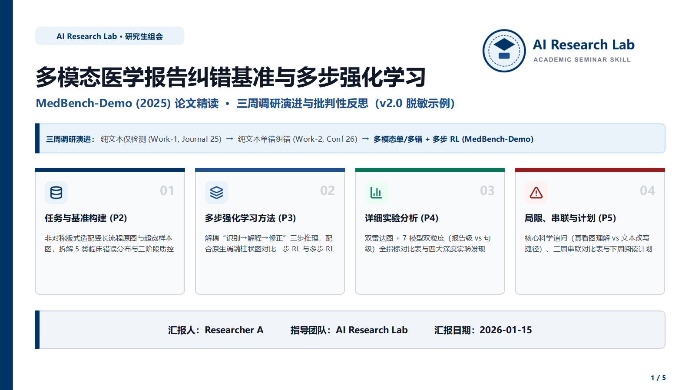
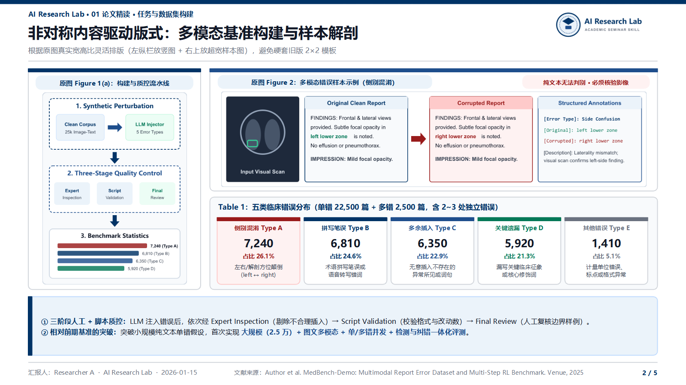
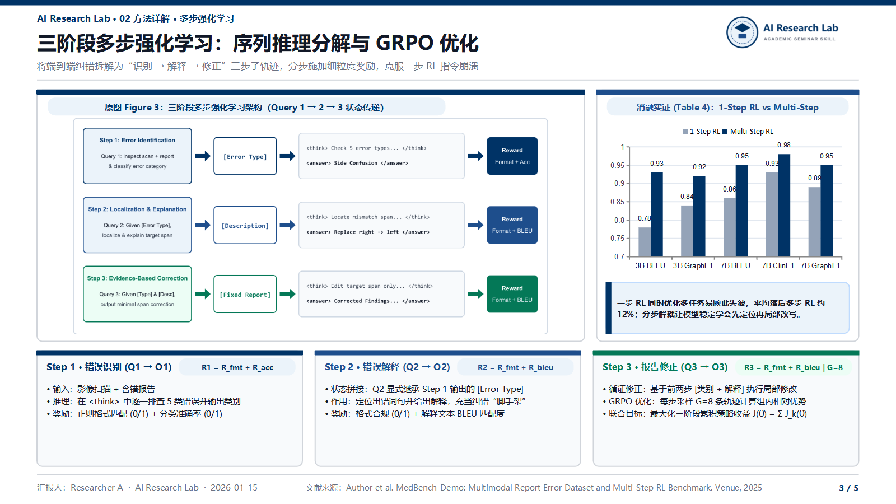
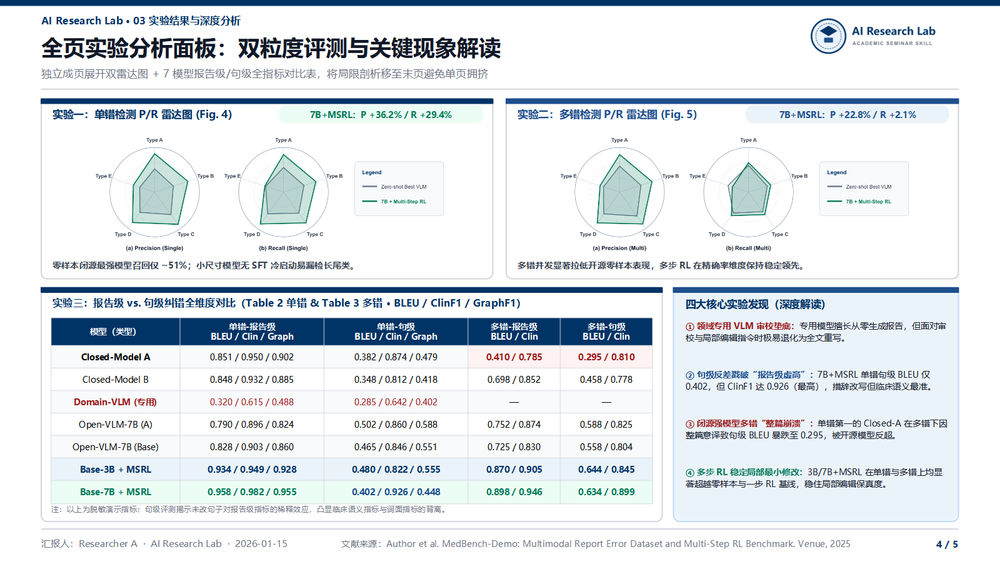
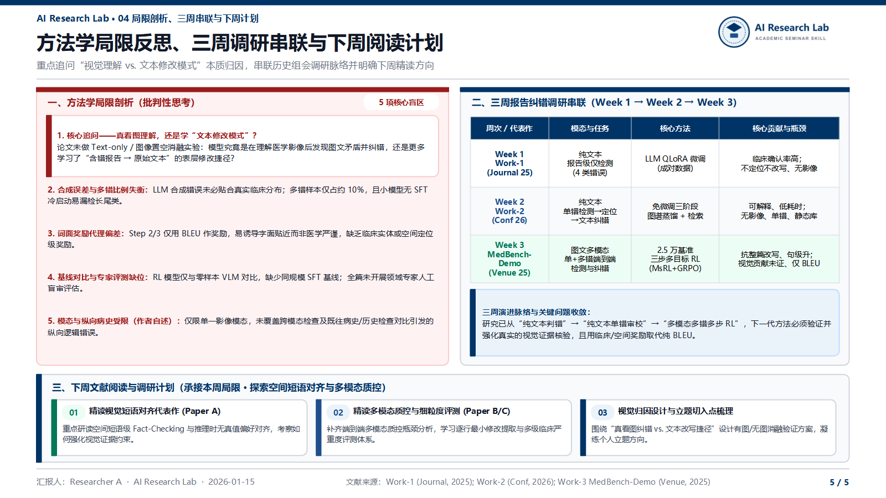

# 学术组会高密度汇报 PPT 生成技能 (`group-meeting-ppt` v2.0)

这是一个面向 **Google Antigravity** 与 **Claude Code** 的研究生学术组会 PPT 制作 Skill（技能包）。它融合了**智能预检 + 轻量 `grill-me` 澄清机制**、`PptxGenJS` + `Lucide` + `Sharp` + `PowerPoint COM` 自动化视觉核验流水线，将论文精读、多组实验对比、批判性反思与多周调研脉络转化为**内容驱动排版、配色克制稳重的 4–5 页学术风演示文稿（`.pptx`）**，并同步生成**逐页详细口播稿**与**3–5 分钟简短进展汇报稿（`.md`）**。

---

## ✨ v2.0 核心特性升级

1. **智能预检 + 轻量 `grill-me`（遇到不确定主动询问）**：
   - 先自动扫描工作区、历史组会 PPT 与输入 PDF，能从文件推断的信息直接沿用，仅对缺失或存在分歧的决策点逐一快速询问（带推荐项）。
   - **自动检测 Logo 与身份信息**：若项目中没有真实学校/实验室 Logo，会自动询问 Logo 图片路径以及汇报人姓名、实验室名称，避免硬编码占位信息。
2. **内容驱动灵活排版（拒绝硬套固定模板）**：
   - 摒弃机械套用旧版固定 `2×2` 或 `4 窄列` 模板的做法，提供**模块化版式菜单**：根据论文原图的真实宽高比（竖长流程 / 超宽样例 / 双雷达图）与表格密度灵活选择每页布局。
   - 推荐 **5 页深度结构**：P1 封面与多周演进导航 → P2 非对称数据集与样例解剖 → P3 方法架构与消融柱状图 → P4 全页详细实验分析面板 → P5 批判性局限剖析 + 多周文献串联 + 下周计划。
3. **四色克制、深浅平衡的学术配色 + “三不原则”**：
   - 默认主题收敛为 **深海蓝 (`#003366`) + 克制钢蓝 (`#1E4E8C`) + 森林深绿 (`#047857`) + 沉稳暗红 (`#991B1B`)**，搭配白底页面与极浅柔底卡片（`#F8FAFC` / `#EBF3FA`）。
   - 明确**“三不原则”**：不用高饱和亮紫/亮橙/荧光蓝混搭、不用过于寡淡的浅灰表头、不用大面积压抑深黑底块。
   - 内置备选低饱和 **墨绿 / 暖灰** 主题，并支持用户指定所在高校的品牌主色。
4. **批判性思考引导与防错核验闭环**：
   - 在局限剖析页主动引导深层科学追问（如多模态任务必问*“模型究竟是理解了图像，还是学习了文本表层修改模式？”*）。
   - 保留 PDF 原图裁剪前核对页码与题注上方精准裁剪规范、每页底部单行文献来源标注、PowerPoint COM 逐页导出 PNG 视觉核验以及双版本 Markdown 演讲稿生成。

---

## 🖼️ v2.0 五页内容驱动版式预览（100% 脱敏示例）

| 第 1 页：封面与三周演进导航 | 第 2 页：非对称数据集与样例解剖 |
| :---: | :---: |
|  |  |
| **第 3 页：方法架构图与消融柱状图** | **第 4 页：全页详细实验分析面板** |
|  |  |
| **第 5 页：局限追问、三周串联与下周计划** | |
|  | |

---

## 📂 仓库目录结构

```text
group-meeting-ppt-skill/
├── SKILL.md                                  # v2.0 核心技能规范（轻量 grill-me + 灵活版式菜单 + 四色克制守则）
├── README.md                                 # 中文说明文档与 5 页脱敏版式预览
├── scripts/
│   ├── crop_and_verify_figs.cjs              # 基于 Sharp 的 PDF 论文原图裁剪与宽高比校验脚本
│   └── render_slides.ps1                     # 基于 PowerPoint COM 的幻灯片逐页导出 PNG 检查脚本
├── examples/
│   ├── build_demo.cjs                        # v2.0 五页内容驱动脱敏示例构建脚本（零硬编码本地路径）
│   ├── demo-group-meeting.pptx               # 生成的 5 页脱敏示例演示文稿
│   ├── demo-speech-detailed.md               # 配套 8–10 分钟逐页详细演讲稿模板
│   └── demo-speech-progress-3min.md          # 配套 3–5 分钟个人进展简短汇报稿模板
└── resources/
    ├── lab_logo.png                          # 通用实验室占位徽标（使用时 Agent 会询问您的真实校徽路径）
    └── preview/                              # 1600×900 高清幻灯片预览图 (s01.png–s05.png)
```

---

## 🚀 安装与使用方法

### 1. 安装到全局技能目录（推荐）
将本仓库克隆到 Antigravity / Claude Code 的全局技能目录中，即可在所有本地工作区自动激活：
```bash
git clone https://github.com/0x3fffff/group-meeting-ppt-skill.git ~/.gemini/config/skills/group-meeting-ppt
```

### 2. 安装到单个项目工作区
也可以将其放入当前项目根目录下的 `.agents/skills/group-meeting-ppt`：
```bash
git clone https://github.com/0x3fffff/group-meeting-ppt-skill.git .agents/skills/group-meeting-ppt
```

### 3. 本地运行示例脚本与个性化配置
安装 Node 依赖（`pptxgenjs`、`lucide`、`sharp`）后即可运行示例构建脚本：
```bash
npm install pptxgenjs lucide sharp
node examples/build_demo.cjs
```
在实际对话中使用本技能时，只需提供论文 PDF 路径或笔记，Agent 会自动检测项目中是否已有学校/实验室 Logo——若缺失则会主动询问您的 Logo 文件路径、姓名、实验室名称与汇报侧重点，并按内容动态选择最合适的版式生成 PPT 与双版本演讲稿。
